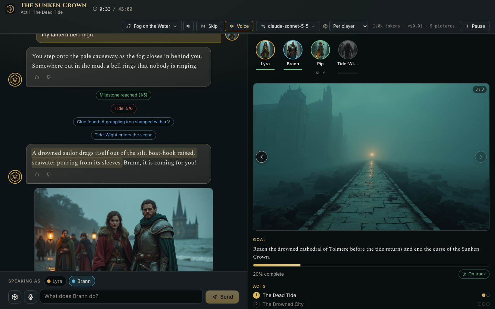
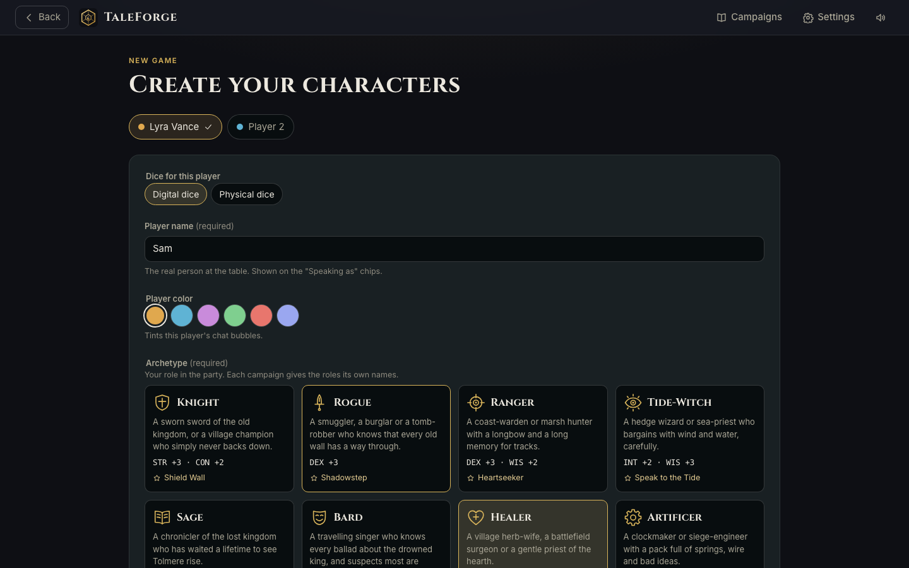
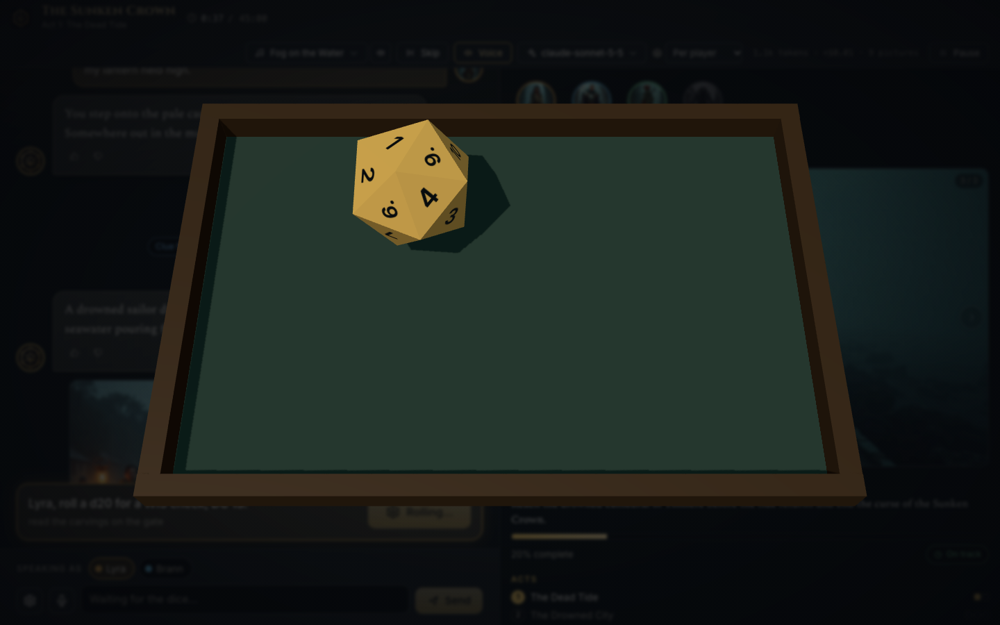
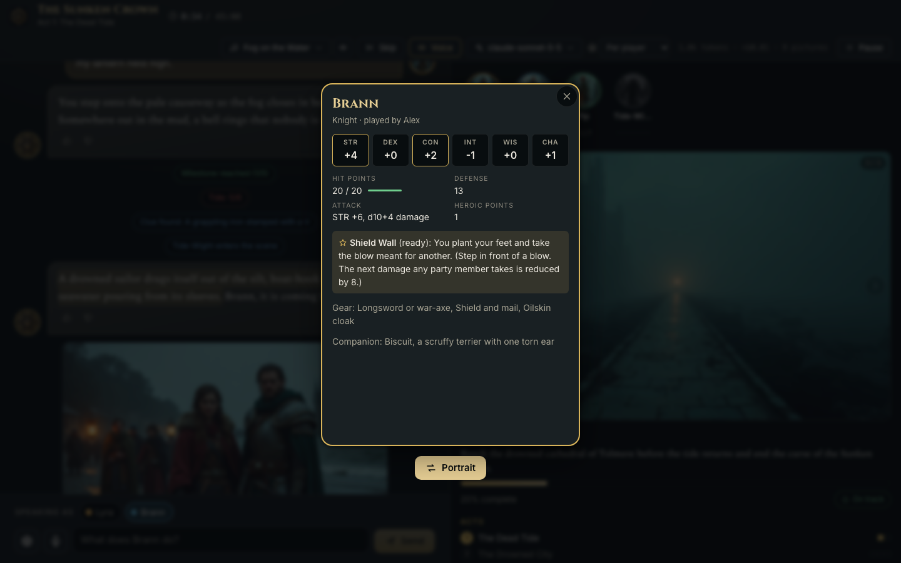
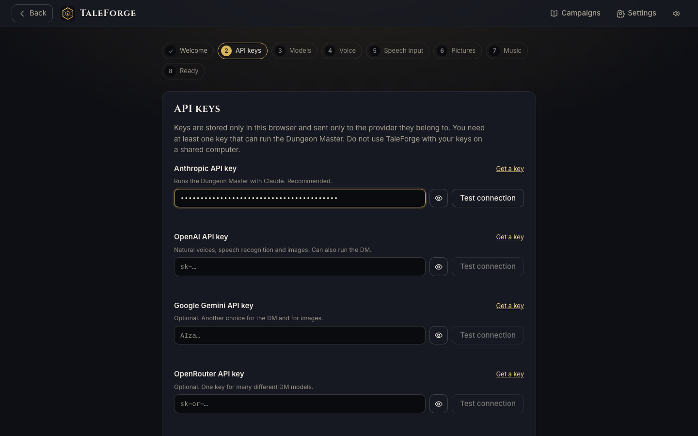
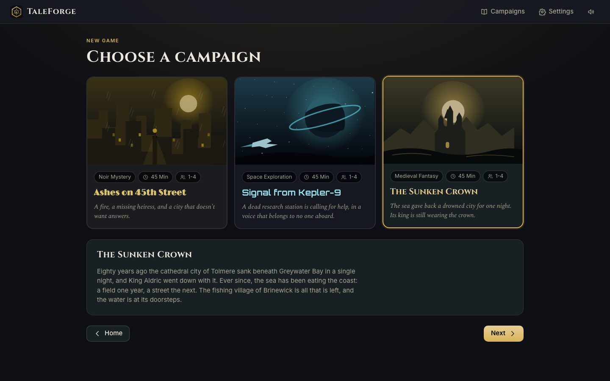
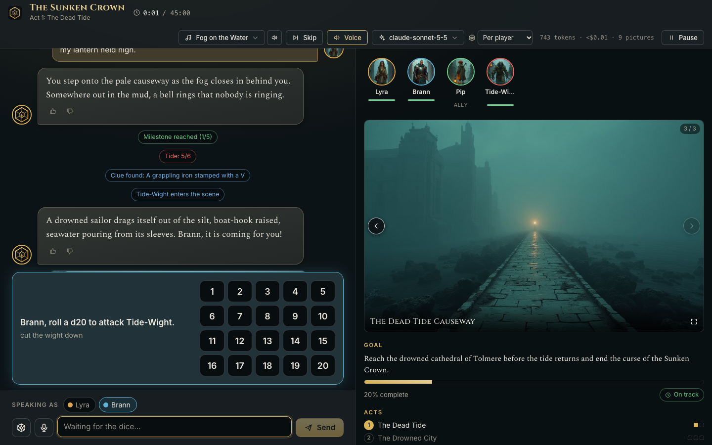
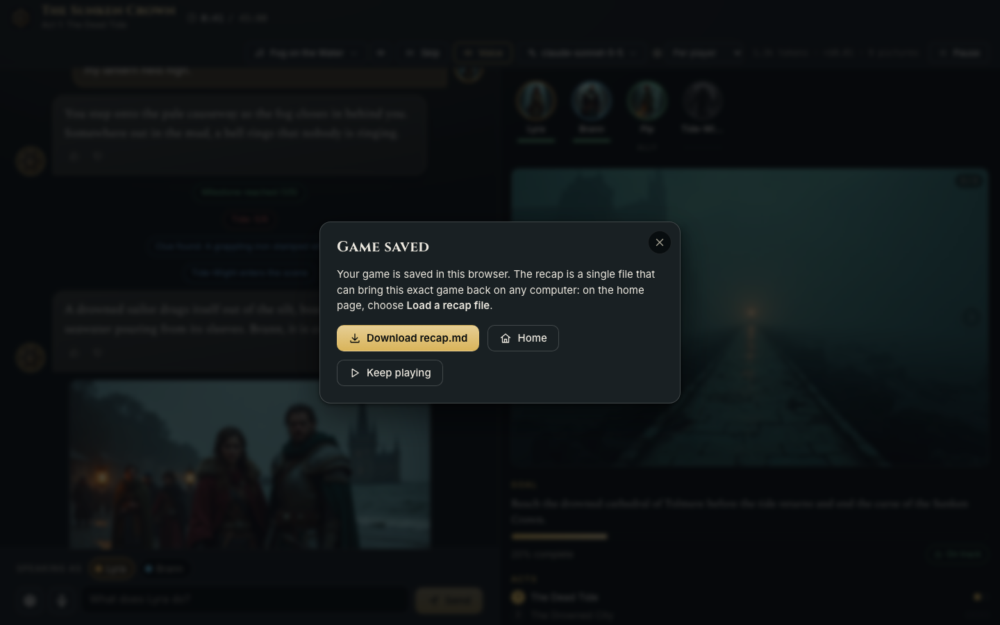
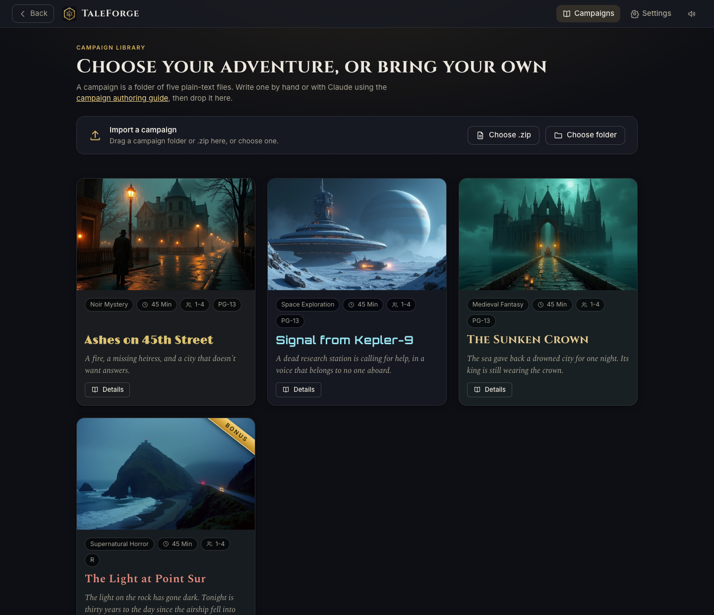

# TaleForge

**An AI Dungeon Master for your table.** One to four players share one computer. The Dungeon Master narrates
aloud, paints the characters and every scene, keeps the music in step with the story, and runs a complete
tabletop adventure in under an hour. You answer by voice or keyboard and roll real or digital dice.

**Play it:** <https://kenproudfoot.github.io/taleforge/>

## Features

- **A Dungeon Master who plays fair.** The AI narrates and decides what happens; a rules engine does every
  roll and every piece of arithmetic. Rolls, damage, conditions and progress all show as cards in the chat.
- **Spoken aloud.** Natural narration with OpenAI or ElevenLabs voices (or the browser's free voice), with
  distinct voices for the characters you meet. Starting to talk interrupts the narrator, like at a real table.
- **Talk back.** Push-to-talk (hold the button or the Space bar) or type. "Speaking as" chips show who has the
  spotlight and switch automatically when the DM turns to someone.
- **Pictures as you play.** Full-body portraits of every character with their name on a card, a party
  picture, the places you visit and big story moments, painted in each campaign's style.
- **Dice your way.** Throw physics-based 3D dice (d4 to d100), or roll real dice and tap in the result. Choose
  per table or per player, and change your mind mid-game.
- **Music that follows the story.** Calm, tension, combat, mystery, triumph and more, crossfading as the
  scene changes and quietening whenever the Dungeon Master speaks.
- **Three complete adventures included:** a drowned-kingdom ghost story, a 1931 noir mystery and a frozen
  science-fiction first-contact story. Each takes about 45 minutes and has several endings.
- **Write your own campaigns** as five plain-text files, by hand or with Claude, and drop them in.
- **Save, recap and resume anywhere.** Every turn is saved. Save & quit writes a `recap.md` that brings the
  exact game back on any computer.
- **No server, no account.** It is a static web page. Your API keys stay in your browser.

| Create characters | Throw the dice | Flip a character card |
|---|---|---|
|  |  |  |

## Getting started

### 1. Get API keys

TaleForge talks directly from your browser to AI providers with your own keys. You need **one key that can
run the Dungeon Master**. Anthropic is recommended; an OpenAI key adds the best voices, speech recognition
on every browser and pictures.

| Provider | What it does in TaleForge | Where to get a key |
|---|---|---|
| **Anthropic** (recommended) | Runs the Dungeon Master and the helper with Claude | [platform.claude.com](https://platform.claude.com/settings/keys) → API keys. Add a little credit under Billing. |
| **OpenAI** | Narrator and character voices, speech recognition, pictures; can also run the DM | [platform.openai.com/api-keys](https://platform.openai.com/api-keys). Image models may require organisation verification. |
| **Google Gemini** (optional) | Pictures, or the DM | [aistudio.google.com/apikey](https://aistudio.google.com/apikey) |
| **ElevenLabs** (optional) | Premium narrator and character voices | [elevenlabs.io](https://elevenlabs.io/app/settings/api-keys) → API keys |
| **OpenRouter** (optional) | One key for many different DM models | [openrouter.ai/keys](https://openrouter.ai/keys) |

### 2. Run the setup wizard

Open TaleForge and choose **Start setup**. The wizard walks through keys (each with a **Test connection**
button), the Dungeon Master and helper models (loaded live from each provider, so new models appear
automatically), the narrator voice (with **Preview**), speech input, pictures (with **Paint a test
picture**) and music volume. Everything can be changed later in **Settings**.

**Recommended models:** a fast, creative mid-size model for the Dungeon Master (for example Claude Sonnet)
with low thinking effort so replies arrive quickly, and a small, cheap model for the helper (for example
Claude Haiku), which writes picture prompts, recaps and name suggestions.

### 3. Keep your setup safe

- **Settings → Backup and protection → Export settings** saves everything to a file. API keys are left out
  unless you tick the box. **Import settings** restores it, in this browser or another.
- **Passphrase:** optionally encrypt the stored keys (AES-GCM). You will be asked for the passphrase each time
  you open TaleForge. There is no recovery if you forget it; you would enter your keys again.

## How to play

1. **New game** → pick a campaign, the number of players and how you want to roll dice.

   

2. **Create a character for each player.** The questions are the same in every campaign; the roles are renamed
   to fit (a Knight in the fantasy story is an Ex-Boxer in the noir one). **Surprise me** fills in anything
   you leave blank, and **Suggest names** offers names that fit the setting. A pet or sidekick can tag along,
   or be a full party member that someone plays.
3. **Begin.** The Dungeon Master sets the scene and asks someone what they do.
4. **Answer.** Pick who is speaking on the **Speaking as** chips (it follows the DM automatically), then type
   or hold the microphone button (or the Space bar when you are not in the text box). Say what your character
   does, not just what you want: "I put my shoulder to the gate" beats "I open the gate".
5. **Roll when asked.** With digital dice, click or flick the dice, or press Space. With physical dice, roll
   yours and tap the number. If a roll fails and you have a **Heroic Point**, you can spend it to reroll or add
   +5. The dice button next to the text box makes a free roll of any die.

   

6. **Watch the right-hand panel.** The roster shows who is in the scene (click anyone for their card, then
   **Stats** to flip it). The scene picture changes as you travel. The state panel tracks the goal, acts,
   encounters, hit points, conditions, clues and the campaign's special resources, plus whether you are on
   time.
7. **The top bar** shows the clock against the target length, the music (pick a mood or follow the story),
   the voice switch and **Skip** for the line being read, the Dungeon Master model (switch it mid-game, even to
   another provider), the dice mode, an estimate of tokens and cost, and **Pause**.

### Saving, recaps and resuming

- The game saves itself after every turn. **Home → Continue a saved game** picks up where you left off.
- **Pause → Save and quit** writes a **recap.md**: a readable summary of the story so far plus the exact game
  state. Download it and you can resume on any computer with **Home → Load a recap file**: the Dungeon Master
  reminds everyone where things stand and carries on.
- **Download a backup** (on each saved game) exports the whole game, pictures included, as a JSON file;
  **Import a game backup** brings it back.

## Campaigns

A campaign is **one folder with five markdown files** (`campaign.md`, `world.md`, `cast.md`, `rules.md`,
`secrets.md`) and an optional `assets/` folder for key art and music. The full specification, a template for
each file and a **copy-paste prompt for Claude** that writes a new campaign for you are in
[docs/CAMPAIGN_AUTHORING.md](docs/CAMPAIGN_AUTHORING.md).

To import one, open the **Campaign library** and drag the folder or a `.zip` onto *Import a campaign*. Any
problems are listed with the file, line, field and a suggested fix.

### Replacing music

Every campaign maps each mood (title, exploration, tension, combat, calm, mystery, triumph, defeat) to a
track. You can change them three ways:

- **For yourself:** Campaign library → *Details* → **Use my own** next to any mood. The file stays in your
  browser.
- **In a campaign pack:** put audio files in the pack's `assets/music/` folder and point the `audio:` map in
  `campaign.md` at them.
- **For your own copy of TaleForge:** replace files in `public/content/audio/music/`, update
  `public/content/audio/tracks.json` and record where they came from in `public/content/audio/LICENSES.md`.
  `npm run import:music -- <file> <track-id>` converts most formats (including Opus) to AAC on macOS, and
  `npm run generate:audio` re-renders the code-composed tracks.

### Connecting other image services

**Settings → Pictures → Custom endpoint** connects any service that accepts a JSON request: give the URL,
an auth header, a request template using `{{prompt}}`, `{{width}}` and `{{height}}`, and the path to the image
in the response (base64, a data URL or an image URL, for example `data.0.b64_json`). A response that is itself
an image also works. Use **Paint a test picture** to check it.

## Deploy your own copy

1. Fork or clone this repository and push it to your GitHub account.
2. In the repository's **Settings → Pages**, set **Source** to **GitHub Actions**.
3. Push to `main`. The workflow in `.github/workflows/ci.yml` lints, typechecks, tests, validates the
   campaigns, runs the browser tests, builds and deploys. The site appears at
   `https://<your-user>.github.io/<repository-name>/`; the build picks up the repository name automatically.

To run it locally: `npm ci` then `npm run dev` (Node 22). See [CLAUDE.md](CLAUDE.md) for every command and
[docs/ARCHITECTURE.md](docs/ARCHITECTURE.md) for how it fits together.

## Troubleshooting

- **The microphone does nothing.** Allow microphone access in the browser's address bar, and check that the
  operating system allows the browser to use it. Browser speech recognition works in Chrome, Edge and Safari;
  in Firefox, add an OpenAI key and choose *OpenAI transcription* under Settings → Speaking.
- **"Could not reach … from the browser (CORS)".** A provider is refusing direct browser calls, or a network
  filter is blocking it. Anthropic, OpenAI, Gemini, OpenRouter and ElevenLabs all accept browser calls; for a
  custom image endpoint, the server must send CORS headers.
- **No sound.** Browsers keep audio off until you click something on the page. Check the speaker buttons in the
  top bar and the volumes in Settings → Music and sound.
- **The narrator sounds robotic.** That is the browser's built-in voice, used when there is no OpenAI or
  ElevenLabs key. Add one in Settings → Narrator voice.
- **No pictures.** Pictures need an OpenAI, Gemini or custom image service. Without one, campaigns use their
  covers and character emblems, and everything else works.
- **The Dungeon Master stopped with an error.** Use **Try again** in the chat. If it keeps failing, switch the
  model from the top bar; your story carries over.
- **Supported browsers:** current Chrome, Edge, Safari and Firefox on desktop. Phones and tablets work, with
  the side panel as tabs above the chat, but a laptop or larger screen is the intended setup.

## Costs

You pay the providers directly, at their API prices. The top bar shows the tokens used and an estimated cost
for the game. **Click it** (or open **Pause → Usage and costs**) for the full breakdown: Dungeon Master,
helper, pictures, narration and speech recognition, tokens per turn, how much of each request was served from
the cache, a projection for the whole game, and a **CSV usage log** to download. **Home** shows the estimate
for each saved game and the total. As a rough guide for a 45-minute game with a mid-size Claude model:

- **Dungeon Master and helper:** usually around a dollar. TaleForge caches the large, unchanging part of every
  request (rules, campaign, characters) so repeated turns cost much less, and folds old turns into a summary
  so long games do not get more expensive per turn.
- **Pictures:** the biggest variable. A session paints about a dozen to twenty pictures, and each is cached
  so it is never paid for twice (replaying a campaign reuses its scenes). **Settings → Pictures → Picture
  quality** is the main lever: high costs about four times medium, and low is a fraction of medium.
- **Voice:** spoken narration adds a little per minute of speech; the browser voice is free.

The estimates use list prices built into TaleForge (checked November 2026); your provider's bill is the real
figure. For a service TaleForge has no price for (ElevenLabs credits, a local image server), set one under
**Settings → Costs**. Check each provider's pricing page for current numbers, and set a spending limit in
each provider's console.

## Privacy

- Your API keys are stored only in this browser (IndexedDB), optionally encrypted with your passphrase, and are
  sent only to the provider each key belongs to. TaleForge has no server and collects nothing.
- What you say and type in a game goes to the AI providers you configured, under their terms.
- **Do not save your keys on a shared or public computer.** Use **Settings** to remove them, or clear the
  site's data in the browser, when you are done.

## Credits

Built with React, three.js, cannon-es, zod and Vite. Music: four tracks supplied by the project owner (made
with Suno) and twelve composed in code for TaleForge; every audio file's origin is recorded in
[public/content/audio/LICENSES.md](public/content/audio/LICENSES.md). Icons and covers are hand-built SVG.
